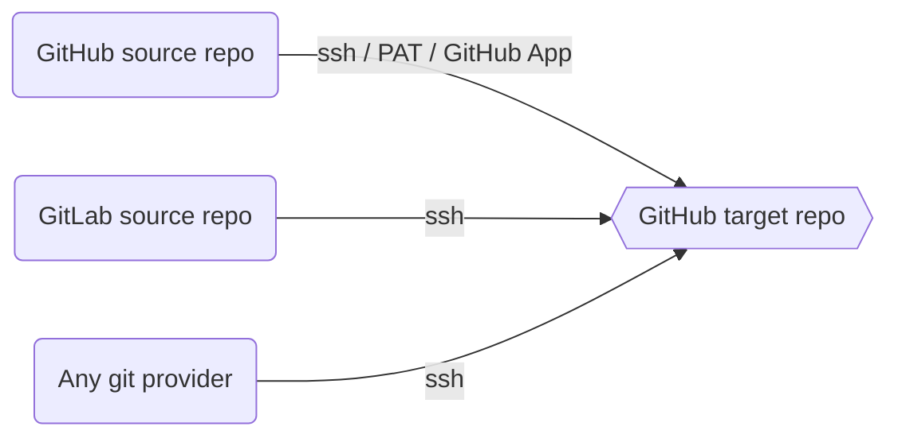

# actions-template-sync

[](https://github.com/AndreasAugustin/actions-template-sync/actions/workflows/ci.yml)
[](https://github.com/AndreasAugustin/actions-template-sync/actions/workflows/test.yml)

A GitHub Action that syncs a source repository into a target repository by opening a pull request. Supports GitHub, GitLab, and any git provider accessible over SSH.



## Features

- Syncs public or private repositories into a GitHub target repo
- Opens a PR with the diff. Skips if no changes exist or a PR is already open.
- Ignores files listed in `.templatesyncignore`
- Supports lifecycle hooks for custom logic at each stage
- Syncs tags and semantic version releases (including prereleases)
- Signs commits with GPG
- Works with GitHub Enterprise Server and custom runners

## Requirements

- A GitHub repository (the target)
- A source repository on GitHub, GitLab, or any git provider with SSH access
- One of: a GitHub token, a GitHub App, an SSH key, or a PAT for authentication

## Install

Add a workflow file to the target repository.

### Public source repository

Create `.github/workflows/template-sync.yml`:

```yaml
on:
  schedule:
  - cron: "0 0 1 * *"
  workflow_dispatch:

jobs:
  repo-sync:
    runs-on: ubuntu-latest
    permissions:
      contents: write
      pull-requests: write

    steps:
      - name: Checkout
        uses: actions/checkout@v6

      - name: actions-template-sync
        uses: AndreasAugustin/actions-template-sync@v2
        with:
          source_repo_path: <owner/repo>
          upstream_branch: <target_branch> # defaults to main
          pr_labels: <label1>,<label2>     # defaults to template_sync
```

The action runs on schedule and opens a PR when the source repository has new changes.

### Private source repository

Private source repos require additional authentication. Three options:

#### Option 1: GitHub App

Generate a token with a [GitHub App](https://docs.github.com/en/developers/apps/getting-started-with-apps/about-apps#about-github-apps) using [tibdex/github-app-token](https://github.com/tibdex/github-app-token).

```yaml
jobs:
  repo-sync:
    runs-on: ubuntu-latest

    steps:
      - name: Generate token
        id: generate_token
        uses: tibdex/github-app-token@v2
        with:
          app_id: ${{ secrets.APP_ID }}
          private_key: ${{ secrets.PRIVATE_KEY }}

      - name: Checkout
        uses: actions/checkout@v6
        with:
          token: ${{ steps.generate_token.outputs.token }}

      - name: actions-template-sync
        uses: AndreasAugustin/actions-template-sync@v2
        with:
          source_gh_token: ${{ steps.generate_token.outputs.token }}
          source_repo_path: <owner/repo>
          upstream_branch: <target_branch>
```

#### Option 2: SSH

Add your private SSH key as a repository secret (for example, `SOURCE_REPO_SSH_PRIVATE_KEY`). [Deployment keys](https://docs.github.com/en/developers/overview/managing-deploy-keys#deploy-keys) work for this. Write permission is not required.

```yaml
jobs:
  repo-sync:
    runs-on: ubuntu-latest
    permissions:
      contents: write
      pull-requests: write

    steps:
      - name: Checkout
        uses: actions/checkout@v6
        with:
          token: ${{ secrets.GITHUB_TOKEN }}

      - name: actions-template-sync
        uses: AndreasAugustin/actions-template-sync@v2
        with:
          source_gh_token: ${{ secrets.GITHUB_TOKEN }}
          source_repo_path: ${{ secrets.SOURCE_REPO_PATH }}
          upstream_branch: ${{ secrets.TARGET_BRANCH }}
          pr_labels: <label1>,<label2>
          source_repo_ssh_private_key: ${{ secrets.SOURCE_REPO_SSH_PRIVATE_KEY }}
```

This also works with non-GitHub providers (GitLab, Gitea). See [test_ssh_gitlab.yml](https://github.com/AndreasAugustin/actions-template-sync/blob/main/.github/workflows/test_ssh_gitlab.yml) for an example.

#### Option 3: PAT

> **Warning:** When using a PAT with a private source repo, the target repo must also be private.

Create a [personal access token](https://docs.github.com/en/authentication/keeping-your-account-and-data-secure/creating-a-personal-access-token).

**Source repo scopes (fine-grained):**

- `contents`: read
- `metadata`: read

**Source repo scopes (classic):**

- `repo`: all
- `read:org`


Grant the source repository access to GitHub Actions in the target repo. Go to Settings > Actions > General.


**Target repo scopes (fine-grained):**

- `contents`: write
- `metadata`: read
- `pull requests`: write
- `organisation:members`: read (required only if adding reviewers or assignees from the org)


**Target repo scopes (classic):**

- `workflow` (also enables `repo`)
- `admin:read`


> **Warning:** Add `persist-credentials: false` to the checkout step. Without it, authentication fails. See [#557](https://github.com/AndreasAugustin/actions-template-sync/issues/557) and [#627](https://github.com/AndreasAugustin/actions-template-sync/issues/627).

```yaml
on:
  schedule:
  - cron: "0 0 1 * *"
  workflow_dispatch:

jobs:
  repo-sync:
    runs-on: ubuntu-latest
    permissions:
      contents: write
      pull-requests: write

    steps:
      - name: Checkout
        uses: actions/checkout@v6
        with:
          token: ${{ secrets.CUSTOM_GITHUB_PAT }}
          persist-credentials: false

      - name: actions-template-sync
        uses: AndreasAugustin/actions-template-sync@v2
        with:
          source_gh_token: ${{ secrets.CUSTOM_GITHUB_PAT }}
          source_repo_path: ${{ secrets.SOURCE_REPO_PATH }}
```

## Configuration

### Inputs

| Variable | Description | Required | Default |
| -------- | ----------- | -------- | ------- |
| `github_token` | **Deprecated.** Use `source_gh_token`. | `true` | `${{ github.token }}` |
| `source_gh_token` | Token for the source repo. | `false` | `${{ github.token }}` |
| `target_gh_token` | Token for the target repo. | `false` | `${{ github.token }}` |
| `source_repo_path` | Source repository path (`owner/repo`). | `true` | |
| `source_branch` | Branch to sync from the source repo. | `false` | Source repo default branch |
| `upstream_branch` | Target branch to sync into. | `false` | Remote default branch |
| `source_repo_ssh_private_key` | Private SSH key for the source repo. | `false` | |
| `pr_branch_name_prefix` | Prefix for branches created by this action. | `false` | `chore/template_sync` |
| `pr_title` | Title for PRs opened by this action. | `false` | `upstream merge template repository` |
| `pr_body` | Body text for PRs. | `false` | `Merge ${SOURCE_REPO} ${TEMPLATE_GIT_HASH}` |
| `pr_labels` | Comma-separated list of PR labels. | `false` | `sync_template` |
| `pr_reviewers` | Comma-separated list of PR reviewers. | `false` | |
| `pr_assignees` | Comma-separated list of PR assignees. | `false` | |
| `pr_commit_msg` | Commit message in the created PR. | `false` | `chore(template): merge template changes :up:` |
| `hostname` | Repository hostname (for GHES). | `false` | `github.com` |
| `is_git_lfs` | Enable git LFS. | `false` | `false` |
| `is_dry_run` | Run without pushing changes or creating a PR. | `false` | `false` |
| `is_allow_hooks` | Enable lifecycle hooks. | `false` | `false` |
| `hooks` | Hook definitions (YAML). See [Lifecycle hooks](#lifecycle-hooks). | `false` | |
| `is_force_push_pr` | Force push and update existing PR. Requires `repository-projects: read` permission. | `false` | `false` |
| `is_pr_cleanup` | Close older PRs targeting the same branch. | `false` | `false` |
| `is_keep_branch_on_pr_cleanup` | Keep the branch when cleaning up a PR. Only works with `is_pr_cleanup`. | `false` | `false` |
| `is_not_source_github` | Set to `true` when the source provider is not GitHub. | `false` | `false` |
| `is_force_deletion` | Force delete files removed in the source repo. Requires changes to `git_remote_pull_params` (see [Force deletion](#force-deletion)). | `false` | `false` |
| `git_user_name` | Committer name. | `false` | `${GITHUB_ACTOR}` |
| `git_user_email` | Committer email. | `false` | `github-action@actions-template-sync.noreply.${SOURCE_REPO_HOSTNAME}` |
| `git_remote_pull_params` | Git remote pull parameters. | `false` | `--allow-unrelated-histories --squash --strategy=recursive -X theirs` |
| `gpg_private_key` | GPG private key for commit signing. | `false` | |
| `gpg_passphrase` | Passphrase for the GPG key. | `false` | |
| `steps` | Comma-separated list of lifecycle steps to run. | `false` | All steps |
| `template_sync_ignore_file_path` | Path to the ignore file. | `false` | `.templatesyncignore` |
| `is_with_tags` | Sync tags from the source repo. | `false` | `false` |
| `is_sync_to_latest_semver` | Sync to the latest semantic version tag. | `false` | `false` |
| `is_include_prerelease` | Include prerelease tags when syncing to latest semver. | `false` | `false` |

### Outputs

| Output | Description |
|--------|-------------|
| `pr_branch` | Branch name used for the PR. Undefined if no changes or the branch already exists. |
| `pr_number` | PR number. Undefined if no PR was created. |
| `template_git_hash` | Git hash of the source repository at sync time. |

### Change the target branch

The action targets the default branch. Override it in the checkout step:

```yaml
- name: Checkout
  uses: actions/checkout@v6
  with:
    ref: <target_branch>
```

## Ignore files

Create a `.templatesyncignore` file in the target repo. It uses [glob patterns](https://en.wikipedia.org/wiki/Glob_(programming)), similar to `.gitignore`.

The file can live at the repo root or inside `.github/`. Set a custom path with `template_sync_ignore_file_path`.

The `.templatesyncignore` file itself cannot be synced. The action restores any changes to it from the source repo.

To ignore all files except specific ones, use the `:!` prefix:

```txt
:!newfile-1.txt
*
```

## Lifecycle hooks

Hooks run custom commands at specific points in the sync process. Enable them with `is_allow_hooks: true`.

Define hooks in a `templatesync.yml` file at the repo root, or inline with the `hooks` input parameter.

### Available hooks

| Hook | Runs before |
|------|-------------|
| `prepull` | Pulling changes from the source repo |
| `precommit` | Committing the changes |
| `prepush` | Pushing to the remote |
| `precleanup` | Closing older PRs |
| `prepr` | Creating the PR |

See [docs/ARCHITECTURE.md](https://github.com/AndreasAugustin/actions-template-sync/blob/main/docs/ARCHITECTURE.md) for the full lifecycle diagram.

### Inline hook example

```yaml
- name: actions-template-sync
  uses: AndreasAugustin/actions-template-sync@v2
  env:
    MY_VAR: "foo"
  with:
    source_repo_path: AndreasAugustin/template.git
    upstream_branch: main
    is_dry_run: true
    is_allow_hooks: true
    hooks: >
      prepull:
        commands:
          - echo 'prepull: adjust local code before pulling'
```

### File-based hook example (`templatesync.yml`)

```yaml
hooks:
  prepull:
    commands:
      - echo "prepull phase ${MY_VAR}"
      - echo 'adjust local code before pulling'
  precommit:
    commands:
      - echo 'add changes before commit'
  prepush:
    commands:
      - echo 'add changes and commits before push'
  precleanup:
    commands:
      - echo 'interact with older PRs before cleanup'
  prepr:
    commands:
      - echo 'final changes before PR creation'
```

If you need tools beyond what the runner provides, install them in a step before the action.

## Lifecycle steps

The action runs these phases in order:

1. **preparation** - Git init, auth (SSH, PAT, or GitHub App), optional GPG setup
2. **prechecks** - Check if the sync branch exists, check if changes are already in history. Skipped when `is_force_push_pr` is `true`.
3. **pull** - Pull changes from the source repo
4. **commit** - Commit the changes
5. **push** - Push to the target. Force push when `is_force_push_pr` is `true`.
6. **pr** - Create labels if needed, create or update the PR, optional cleanup of older PRs
7. **outputs** - Set GitHub Action outputs

When `is_dry_run` is `true`, the push, PR, and cleanup phases are skipped.

Run a subset of steps with the `steps` input. The `preparation` and `outputs` phases always run.

```yaml
steps:
  - name: actions-template-sync (pull only)
    uses: AndreasAugustin/actions-template-sync@v2
    with:
      source_repo_path: <owner/repo>
      steps: "prechecks,pull"

  - name: custom logic
    run: |
      echo "inspect the pulled changes"
      git status

  - name: actions-template-sync (commit and push)
    uses: AndreasAugustin/actions-template-sync@v2
    with:
      source_repo_path: <owner/repo>
      steps: "commit,push,pr"
```

## Signed commits

Export your GPG private key and store it as a repository secret (`GPG_PRIVATE_KEY`). If the key has a passphrase, store that as `GPG_PASSPHRASE`.

The GPG username and email must match `git_user_name` and `git_user_email`.

```bash
# macOS
gpg --armor --export-secret-key jon@doe.example | pbcopy

# Ubuntu
gpg --armor --export-secret-key jon@doe.example -w0 | xclip

# Arch
gpg --armor --export-secret-key jon@doe.example | xclip -selection clipboard -i

# FreeBSD
gpg --armor --export-secret-key jon@doe.example | xclip
```

```yaml
on:
  schedule:
  - cron: "0 0 1 * *"
  workflow_dispatch:

jobs:
  repo-sync:
    runs-on: ubuntu-latest
    permissions:
      contents: write
      pull-requests: write

    steps:
      - name: Checkout
        uses: actions/checkout@v6

      - name: actions-template-sync
        uses: AndreasAugustin/actions-template-sync@v2
        with:
          source_gh_token: ${{ secrets.GITHUB_TOKEN }}
          source_repo_path: <owner/repo>
          git_user_name: # GPG username
          git_user_email: # GPG email
          gpg_private_key: ${{ secrets.GPG_PRIVATE_KEY }}
          # gpg_passphrase: ${{ secrets.GPG_PASSPHRASE }}
```

See [how and why to sign commits](https://dev.to/andreasaugustin/git-how-and-why-to-sign-commits-35dn) for background.

## Force push and PR update

Set `is_force_push_pr` to `true` to force push and update an existing PR. This is useful when workflow metadata changes.

Add the `repository-projects: read` permission:

```yaml
permissions:
  contents: write
  pull-requests: write
  repository-projects: read
```

## Force deletion

Set `is_force_deletion` to `true` to delete files in the target repo that were deleted in the source repo.

This does not work with the default `git_remote_pull_params`. Change it to:

```
git_remote_pull_params: --allow-unrelated-histories --strategy=recursive --no-edit
```

## Labels

The action labels PRs with `template_sync` by default. If the label does not exist, the action creates it. Specify custom labels with `pr_labels`.

## PR cleanup

Set `is_pr_cleanup` to `true` to close older PRs from this action that target the same branch. The action identifies them by the labels set in `pr_labels`.

Set `is_keep_branch_on_pr_cleanup` to `true` to keep the branch when closing the PR.

## Docker

Docker images are available for environments where running a remote action is not possible.

- [Docker Hub](https://hub.docker.com/r/andyaugustin/actions-template-sync)
- [GitHub Container Registry](https://github.com/AndreasAugustin/actions-template-sync/pkgs/container/actions-template-sync)

See [Docker usage guide](https://github.com/AndreasAugustin/actions-template-sync/blob/main/docs/DOCKER.md) for setup.

## GHES and custom runners

The action requires bash, [GitHub CLI](https://github.com/cli/cli), and git on the runner.

Optional dependencies based on features used:

- [git LFS](https://github.com/git-lfs/git-lfs) for `is_git_lfs`
- [yq](https://github.com/mikefarah/yq) for lifecycle hooks
- gpg for commit signing

Set `hostname` to your GHES domain.

## Examples

- [Self-usage workflow](https://github.com/AndreasAugustin/actions-template-sync/blob/main/.github/workflows/actions_template_sync.yml)
- [Dev.to guide](https://dev.to/andreasaugustin/github-actions-template-sync-1g9k)
- [GitHub guide](https://github.com/AndreasAugustin/teaching/blob/main/docs/git/git_action_sync.md)
- [Blog post by dotdc](https://0xdc.me/blog/github-templates-and-repository-sync/)

## Troubleshooting

**`refusing to allow a GitHub App to create or update workflow ... without 'workflows' permission`**

The PAT in `target_gh_token` is missing the `workflow` scope. `GITHUB_TOKEN` cannot be granted `workflow` permission. Create a PAT with `workflow` scope:

1. [Create a PAT](https://docs.github.com/en/authentication/keeping-your-account-and-data-secure/managing-your-personal-access-tokens#creating-a-fine-grained-personal-access-token) with the `workflow` scope.
2. [Store it as a repository secret](https://docs.github.com/en/actions/security-guides/using-secrets-in-github-actions#creating-secrets-for-a-repository).
3. Pass it as `target_gh_token` and add `persist-credentials: false` to the checkout step.

```yaml
- name: Checkout
  uses: actions/checkout@v6
  with:
    persist-credentials: false

- name: actions-template-sync
  uses: AndreasAugustin/actions-template-sync@v2
  with:
    source_gh_token: ${{ secrets.GITHUB_TOKEN }}
    target_gh_token: ${{ secrets.<secret_name> }}
    source_repo_path: <owner/repo>
```

**`GitHub Actions is not permitted to create or approve pull requests`**

Go to Settings > Actions > General. Select "Allow GitHub Actions to create and approve pull requests" under Workflow permissions.

## Comparison

| Feature | actions-template-sync | [github-sync](https://github.com/repo-sync/github-sync) | [git-repo-sync](https://github.com/it3xl/git-repo-sync) | [action-template-repository-sync](https://github.com/ahmadnassri/action-template-repository-sync) |
| ------- | --------------------- | ------------ | ------------- | --------------------------------- |
| GitHub Action | ✅ | ✅ | ❌ | ✅ |
| Lifecycle hooks | ✅ | ❌ | ❌ | ❌ |
| Docker image | ✅ | ❌ | ❌ | ✅ |
| Private to public sync | ✅ PAT, SSH, App | ✅ PAT, SSH | ❌ | ✅ PAT |
| Private to private sync | ✅ PAT, SSH, App | ✅ PAT, SSH | ❌ | ✅ PAT |
| Public to public sync | ✅ | ✅ | ❌ | ✅ |
| Two-way sync | ❌ | ✅ | ❌ | ❌ |
| Third-party to GitHub | ✅ | ✅ | ❌ | ❌ |
| Dry run | ✅ | ❌ | ❌ | ✅ |
| Ignore files | ✅ | ❌ | ❌ | ✅ |
| Signed commits | ✅ | ❌ | ❌ | ❌ |

## Release notes

**v2:**

- Git LFS is no longer enabled by default. Use `is_git_lfs` to enable.
- Changed from a Docker action to a [composite action](https://docs.github.com/en/actions/creating-actions/creating-a-composite-action) for better compatibility when chaining actions.
- Git config is now local instead of global.

**v1:**

- `upstream_branch` no longer defaults to `main`. It uses the remote default branch.

**v0.5.2:**

- The `templateversionrc` file is no longer required. Delete it from target repositories.

## Debug

Create a secret named `ACTIONS_STEP_DEBUG` with value `true`. See [enabling debug logging](https://docs.github.com/en/actions/managing-workflow-runs/enabling-debug-logging).

## Development

See the [Makefile](https://github.com/AndreasAugustin/actions-template-sync/blob/main/Makefile) for development targets:

```bash
make help
```

Contributions are welcome. See [contributing guidelines](https://github.com/AndreasAugustin/actions-template-sync/blob/main/.github/CONTRIBUTING.md) and [architecture docs](https://github.com/AndreasAugustin/actions-template-sync/blob/main/docs/README.md).

## Sponsorship

If this action helps your team, consider [sponsoring the project](https://github.com/sponsors/AndreasAugustin).

## Contributors

<!-- ALL-CONTRIBUTORS-BADGE:START - Do not remove or modify this section -->
[](#contributors-)
<!-- ALL-CONTRIBUTORS-BADGE:END -->

<!-- ALL-CONTRIBUTORS-LIST:START - Do not remove or modify this section -->
<!-- prettier-ignore-start -->
<!-- markdownlint-disable -->
<table>
  <tbody>
    <tr>
      <td align="center" valign="top" width="14.28%"><a href="https://github.com/AndreasAugustin"><br /><sub><b>andy Augustin</b></sub></a><br /><a href="https://github.com/AndreasAugustin/actions-template-sync/commits?author=AndreasAugustin" title="Documentation">📖</a> <a href="https://github.com/AndreasAugustin/actions-template-sync/commits?author=AndreasAugustin" title="Code">💻</a> <a href="https://github.com/AndreasAugustin/actions-template-sync/pulls?q=is%3Apr+reviewed-by%3AAndreasAugustin" title="Reviewed Pull Requests">👀</a> <a href="#security-AndreasAugustin" title="Security">🛡️</a> <a href="#ideas-AndreasAugustin" title="Ideas, Planning, & Feedback">🤔</a> <a href="#question-AndreasAugustin" title="Answering Questions">💬</a> <a href="#example-AndreasAugustin" title="Examples">💡</a> <a href="#content-AndreasAugustin" title="Content">🖋</a> <a href="#blog-AndreasAugustin" title="Blogposts">📝</a> <a href="#maintenance-AndreasAugustin" title="Maintenance">🚧</a> <a href="#infra-AndreasAugustin" title="Infrastructure (Hosting, Build-Tools, etc)">🚇</a> <a href="#platform-AndreasAugustin" title="Packaging/porting to new platform">📦</a> <a href="https://github.com/AndreasAugustin/actions-template-sync/commits?author=AndreasAugustin" title="Tests">⚠️</a></td>
      <td align="center" valign="top" width="14.28%"><a href="https://www.iit.it/people/ugo-pattacini"><br /><sub><b>Ugo Pattacini</b></sub></a><br /><a href="https://github.com/AndreasAugustin/actions-template-sync/commits?author=pattacini" title="Documentation">📖</a></td>
      <td align="center" valign="top" width="14.28%"><a href="https://github.com/jg-rivera"><br /><sub><b>Jose Gabrielle Rivera</b></sub></a><br /><a href="https://github.com/AndreasAugustin/actions-template-sync/commits?author=jg-rivera" title="Code">💻</a></td>
      <td align="center" valign="top" width="14.28%"><a href="http://pdrittenhouse.com"><br /><sub><b>P.D. Rittenhouse</b></sub></a><br /><a href="#ideas-pdrittenhouse" title="Ideas, Planning, & Feedback">🤔</a></td>
      <td align="center" valign="top" width="14.28%"><a href="https://github.com/Daniel-Boll"><br /><sub><b>Daniel Boll</b></sub></a><br /><a href="https://github.com/AndreasAugustin/actions-template-sync/issues?q=author%3ADaniel-Boll" title="Bug reports">🐛</a></td>
      <td align="center" valign="top" width="14.28%"><a href="https://github.com/albertschwarzkopf"><br /><sub><b>albertschwarzkopf</b></sub></a><br /><a href="#ideas-albertschwarzkopf" title="Ideas, Planning, & Feedback">🤔</a></td>
      <td align="center" valign="top" width="14.28%"><a href="http://akulpillai.com"><br /><sub><b>Akul Pillai</b></sub></a><br /><a href="#security-akulpillai" title="Security">🛡️</a></td>
    </tr>
    <tr>
      <td align="center" valign="top" width="14.28%"><a href="https://github.com/steveizzle"><br /><sub><b>Stefan Riembauer</b></sub></a><br /><a href="#ideas-steveizzle" title="Ideas, Planning, & Feedback">🤔</a></td>
      <td align="center" valign="top" width="14.28%"><a href="http://fabriziocacicia.com"><br /><sub><b>Fabrizio Cacicia</b></sub></a><br /><a href="#security-fabriziocacicia" title="Security">🛡️</a> <a href="https://github.com/AndreasAugustin/actions-template-sync/issues?q=author%3Afabriziocacicia" title="Bug reports">🐛</a></td>
      <td align="center" valign="top" width="14.28%"><a href="https://github.com/JTunis"><br /><sub><b>Justin Tunis</b></sub></a><br /><a href="#ideas-JTunis" title="Ideas, Planning, & Feedback">🤔</a> <a href="https://github.com/AndreasAugustin/actions-template-sync/commits?author=JTunis" title="Code">💻</a> <a href="https://github.com/AndreasAugustin/actions-template-sync/issues?q=author%3AJTunis" title="Bug reports">🐛</a></td>
      <td align="center" valign="top" width="14.28%"><a href="https://mikematos84.github.io"><br /><sub><b>Michael Matos</b></sub></a><br /><a href="https://github.com/AndreasAugustin/actions-template-sync/issues?q=author%3Amikematos84" title="Bug reports">🐛</a></td>
      <td align="center" valign="top" width="14.28%"><a href="https://github.com/fatmcgav-depop"><br /><sub><b>Gavin Williams</b></sub></a><br /><a href="#ideas-fatmcgav-depop" title="Ideas, Planning, & Feedback">🤔</a></td>
      <td align="center" valign="top" width="14.28%"><a href="https://github.com/msiebeneicher"><br /><sub><b>Marc Siebeneicher</b></sub></a><br /><a href="#ideas-msiebeneicher" title="Ideas, Planning, & Feedback">🤔</a> <a href="https://github.com/AndreasAugustin/actions-template-sync/commits?author=msiebeneicher" title="Code">💻</a> <a href="https://github.com/AndreasAugustin/actions-template-sync/issues?q=author%3Amsiebeneicher" title="Bug reports">🐛</a> <a href="https://github.com/AndreasAugustin/actions-template-sync/commits?author=msiebeneicher" title="Documentation">📖</a></td>
      <td align="center" valign="top" width="14.28%"><a href="https://github.com/LuisHenri"><br /><sub><b>Luís Henrique A. Schünemann</b></sub></a><br /><a href="#ideas-LuisHenri" title="Ideas, Planning, & Feedback">🤔</a> <a href="https://github.com/AndreasAugustin/actions-template-sync/commits?author=LuisHenri" title="Documentation">📖</a> <a href="https://github.com/AndreasAugustin/actions-template-sync/commits?author=LuisHenri" title="Code">💻</a></td>
    </tr>
    <tr>
      <td align="center" valign="top" width="14.28%"><a href="https://github.com/george-gca"><br /><sub><b>George</b></sub></a><br /><a href="#question-george-gca" title="Answering Questions">💬</a> <a href="https://github.com/AndreasAugustin/actions-template-sync/commits?author=george-gca" title="Documentation">📖</a> <a href="#ideas-george-gca" title="Ideas, Planning, & Feedback">🤔</a></td>
      <td align="center" valign="top" width="14.28%"><a href="http://www.linkedin.com/in/pedrorrivero/"><br /><sub><b>Pedro Rivero</b></sub></a><br /><a href="#ideas-pedrorrivero" title="Ideas, Planning, & Feedback">🤔</a></td>
      <td align="center" valign="top" width="14.28%"><a href="https://github.com/ebronson68"><br /><sub><b>Eleanor Bronson</b></sub></a><br /><a href="#ideas-ebronson68" title="Ideas, Planning, & Feedback">🤔</a></td>
      <td align="center" valign="top" width="14.28%"><a href="https://github.com/marvin-belonio"><br /><sub><b>Marvin Osswald</b></sub></a><br /><a href="https://github.com/AndreasAugustin/actions-template-sync/commits?author=marvin-belonio" title="Documentation">📖</a></td>
      <td align="center" valign="top" width="14.28%"><a href="https://github.com/dotdc"><br /><sub><b>David Calvert</b></sub></a><br /><a href="https://github.com/AndreasAugustin/actions-template-sync/commits?author=dotdc" title="Documentation">📖</a> <a href="https://github.com/AndreasAugustin/actions-template-sync/issues?q=author%3Adotdc" title="Bug reports">🐛</a> <a href="https://github.com/AndreasAugustin/actions-template-sync/commits?author=dotdc" title="Code">💻</a> <a href="#maintenance-dotdc" title="Maintenance">🚧</a> <a href="#blog-dotdc" title="Blogposts">📝</a></td>
      <td align="center" valign="top" width="14.28%"><a href="https://blog.airey.be"><br /><sub><b>Andy Airey</b></sub></a><br /><a href="https://github.com/AndreasAugustin/actions-template-sync/issues?q=author%3Aaairey" title="Bug reports">🐛</a> <a href="https://github.com/AndreasAugustin/actions-template-sync/pulls?q=is%3Apr+reviewed-by%3Aaairey" title="Reviewed Pull Requests">👀</a></td>
      <td align="center" valign="top" width="14.28%"><a href="https://fs02.github.io/"><br /><sub><b>Surya Asriadie</b></sub></a><br /><a href="https://github.com/AndreasAugustin/actions-template-sync/issues?q=author%3AFs02" title="Bug reports">🐛</a></td>
    </tr>
    <tr>
      <td align="center" valign="top" width="14.28%"><a href="https://github.com/jellllly420"><br /><sub><b>jellllly420</b></sub></a><br /><a href="#ideas-jellllly420" title="Ideas, Planning, & Feedback">🤔</a> <a href="#question-jellllly420" title="Answering Questions">💬</a> <a href="https://github.com/AndreasAugustin/actions-template-sync/commits?author=jellllly420" title="Documentation">📖</a></td>
      <td align="center" valign="top" width="14.28%"><a href="http://www.xontab.com"><br /><sub><b>Shaun Tabone</b></sub></a><br /><a href="https://github.com/AndreasAugustin/actions-template-sync/commits?author=xontab" title="Code">💻</a></td>
      <td align="center" valign="top" width="14.28%"><a href="https://github.com/kevin-aude"><br /><sub><b>Kevin AUDE</b></sub></a><br /><a href="#ideas-kevin-aude" title="Ideas, Planning, & Feedback">🤔</a> <a href="https://github.com/AndreasAugustin/actions-template-sync/commits?author=kevin-aude" title="Code">💻</a></td>
      <td align="center" valign="top" width="14.28%"><a href="https://github.com/Jnig"><br /><sub><b>Jakob</b></sub></a><br /><a href="https://github.com/AndreasAugustin/actions-template-sync/pulls?q=is%3Apr+reviewed-by%3Ajnig" title="Reviewed Pull Requests">👀</a></td>
      <td align="center" valign="top" width="14.28%"><a href="https://kevin.deldycke.com"><br /><sub><b>Kevin Deldycke</b></sub></a><br /><a href="https://github.com/AndreasAugustin/actions-template-sync/issues?q=author%3Akdeldycke" title="Bug reports">🐛</a> <a href="#ideas-kdeldycke" title="Ideas, Planning, & Feedback">🤔</a> <a href="https://github.com/AndreasAugustin/actions-template-sync/commits?author=kdeldycke" title="Code">💻</a></td>
      <td align="center" valign="top" width="14.28%"><a href="https://github.com/JessicaS11"><br /><sub><b>Jessica Scheick</b></sub></a><br /><a href="https://github.com/AndreasAugustin/actions-template-sync/issues?q=author%3AJessicaS11" title="Bug reports">🐛</a></td>
      <td align="center" valign="top" width="14.28%"><a href="https://github.com/gasbi"><br /><sub><b>Gaspar Melsion</b></sub></a><br /><a href="#ideas-gasbi" title="Ideas, Planning, & Feedback">🤔</a></td>
    </tr>
    <tr>
      <td align="center" valign="top" width="14.28%"><a href="https://github.com/kanno41"><br /><sub><b>Ken Harding</b></sub></a><br /><a href="https://github.com/AndreasAugustin/actions-template-sync/commits?author=kanno41" title="Code">💻</a> <a href="https://github.com/AndreasAugustin/actions-template-sync/issues?q=author%3Akanno41" title="Bug reports">🐛</a></td>
      <td align="center" valign="top" width="14.28%"><a href="https://jakobhavtorn.github.io/"><br /><sub><b>Jakob Drachmann Havtorn</b></sub></a><br /><a href="#ideas-JakobHavtorn" title="Ideas, Planning, & Feedback">🤔</a></td>
      <td align="center" valign="top" width="14.28%"><a href="https://github.com/brian6932"><br /><sub><b>Brian</b></sub></a><br /><a href="https://github.com/AndreasAugustin/actions-template-sync/commits?author=brian6932" title="Documentation">📖</a></td>
      <td align="center" valign="top" width="14.28%"><a href="https://github.com/MuriloChianfa"><br /><sub><b>MuriloChianfa</b></sub></a><br /><a href="https://github.com/AndreasAugustin/actions-template-sync/commits?author=MuriloChianfa" title="Documentation">📖</a></td>
      <td align="center" valign="top" width="14.28%"><a href="https://github.com/davidsnyder"><br /><sub><b>David Snyder</b></sub></a><br /><a href="#research-davidsnyder" title="Research">🔬</a></td>
      <td align="center" valign="top" width="14.28%"><a href="https://github.com/technicallyjoe"><br /><sub><b>Jonathan Østrup</b></sub></a><br /><a href="#ideas-TechnicallyJoe" title="Ideas, Planning, & Feedback">🤔</a> <a href="https://github.com/AndreasAugustin/actions-template-sync/commits?author=TechnicallyJoe" title="Code">💻</a></td>
      <td align="center" valign="top" width="14.28%"><a href="https://natwelch.com"><br /><sub><b>Nat Welch</b></sub></a><br /><a href="https://github.com/AndreasAugustin/actions-template-sync/issues?q=author%3Aicco" title="Bug reports">🐛</a> <a href="https://github.com/AndreasAugustin/actions-template-sync/commits?author=icco" title="Code">💻</a></td>
    </tr>
    <tr>
      <td align="center" valign="top" width="14.28%"><a href="https://github.com/PepijnB"><br /><sub><b>Pepijn Boer</b></sub></a><br /><a href="https://github.com/AndreasAugustin/actions-template-sync/issues?q=author%3APepijnB" title="Bug reports">🐛</a> <a href="https://github.com/AndreasAugustin/actions-template-sync/commits?author=PepijnB" title="Documentation">📖</a></td>
      <td align="center" valign="top" width="14.28%"><a href="https://github.com/alexvanderberkel"><br /><sub><b>Alex</b></sub></a><br /><a href="https://github.com/AndreasAugustin/actions-template-sync/commits?author=alexvanderberkel" title="Code">💻</a> <a href="#ideas-alexvanderberkel" title="Ideas, Planning, & Feedback">🤔</a> <a href="https://github.com/AndreasAugustin/actions-template-sync/pulls?q=is%3Apr+reviewed-by%3Aalexvanderberkel" title="Reviewed Pull Requests">👀</a> <a href="https://github.com/AndreasAugustin/actions-template-sync/commits?author=alexvanderberkel" title="Tests">⚠️</a></td>
      <td align="center" valign="top" width="14.28%"><a href="https://github.com/yuhengshen"><br /><sub><b>yuhengshen</b></sub></a><br /><a href="https://github.com/AndreasAugustin/actions-template-sync/issues?q=author%3Ayuhengshen" title="Bug reports">🐛</a> <a href="https://github.com/AndreasAugustin/actions-template-sync/commits?author=yuhengshen" title="Code">💻</a></td>
      <td align="center" valign="top" width="14.28%"><a href="https://www.linkedin.com/in/cjlpowers"><br /><sub><b>Chris Powers</b></sub></a><br /><a href="https://github.com/AndreasAugustin/actions-template-sync/commits?author=cjlpowers" title="Code">💻</a></td>
      <td align="center" valign="top" width="14.28%"><a href="http://toshy.dev"><br /><sub><b>ToshY</b></sub></a><br /><a href="https://github.com/AndreasAugustin/actions-template-sync/commits?author=ToshY" title="Code">💻</a></td>
      <td align="center" valign="top" width="14.28%"><a href="https://github.com/KLAVIATURKIN"><br /><sub><b>Yuriy</b></sub></a><br /><a href="#ideas-KLAVIATURKIN" title="Ideas, Planning, & Feedback">🤔</a></td>
      <td align="center" valign="top" width="14.28%"><a href="https://github.com/Eric-Liu-SANDAG"><br /><sub><b>Eric Liu</b></sub></a><br /><a href="https://github.com/AndreasAugustin/actions-template-sync/commits?author=Eric-Liu-SANDAG" title="Documentation">📖</a></td>
    </tr>
    <tr>
      <td align="center" valign="top" width="14.28%"><a href="https://github.com/mzglinski"><br /><sub><b>mzglinski</b></sub></a><br /><a href="https://github.com/AndreasAugustin/actions-template-sync/commits?author=mzglinski" title="Code">💻</a></td>
    </tr>
  </tbody>
</table>

<!-- markdownlint-restore -->
<!-- prettier-ignore-end -->

<!-- ALL-CONTRIBUTORS-LIST:END -->

This project follows the [all-contributors](https://github.com/all-contributors/all-contributors) specification. Contributions of any kind are welcome.
